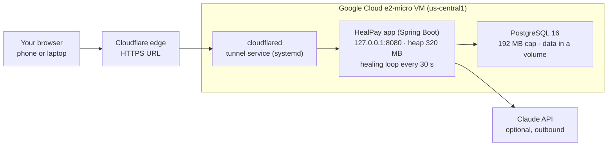

# HealPay AI — Deploying to Google Cloud (Free Tier)

*Detailed step-by-step guide · Nov 24, 2026. A shorter version is in [`DEPLOY-GCP.md`](DEPLOY-GCP.md).*

## Overview

By the end of this guide, HealPay AI runs 24/7 on a free Google Cloud e2-micro VM. You open it over HTTPS from any network, including your phone, at a Cloudflare URL.



Requests flow left to right into the VM. The app makes only outbound calls, to Postgres inside the VM and, if you enable it, to the Claude API.

- **What runs on the VM:** two Docker containers. One is the HealPay Spring Boot app, the other is PostgreSQL 16. Both are memory-capped to fit the VM's ~1 GB RAM, with 2 GB of swap as a safety net.
- **How people reach it:** through a Cloudflare Tunnel. The VM opens an outbound connection to Cloudflare, so no inbound ports, firewall rules or certificates are needed. The app listens only on `127.0.0.1:8080` inside the VM.
- **Time needed:** about 60–90 minutes the first time. Building the image on the VM takes 5–10 minutes of that.
- **Cost:** ₹0 if you stay inside the Always Free limits: one e2-micro VM in `us-west1`, `us-central1` or `us-east1`, a 30 GB standard disk, and 1 GB/month of outbound traffic from North America. Claude API usage, if you enable it, is billed separately by Anthropic.

Free-tier rules can change. Check [cloud.google.com/free](https://cloud.google.com/free) before you start, and set the budget alert in Step 1.

## Prerequisites

Have these ready before Step 1. All of them are free.

- [ ] **Google account** (Gmail is fine) and a **credit or debit card** for Google Cloud's identity check. Always Free resources are not charged.
- [ ] **HealPay code on GitHub** in `jithukkris/AI-2026`, pushed from your Mac. If the repo is private, you'll also need a GitHub token with *Contents: Read* access (Step 4).
- [ ] **A modern browser.** The VM's terminal opens in a browser tab, so you don't need SSH keys.
- [ ] **Three strong passwords** for the database, the `admin` login and the `viewer` login. Store them in a password manager.
- [ ] *Optional:* a **Claude API key** from [console.anthropic.com](https://console.anthropic.com), if you want live Claude instead of the rule-based mock AI.
- [ ] *Optional:* a **Cloudflare account** and a domain on Cloudflare DNS, only for a permanent URL (Step 7, Option B).

**Before you deploy, check it works locally:** `mvn test` passes and `mvn spring-boot:run` starts on your Mac. Fix problems locally first, because debugging on a 1 GB VM is slow.

## Step 1 — Google Cloud account, project and budget alert

In this step you get a project with billing linked and an email alert set at ₹100/month, before any resource exists.

1. Go to [console.cloud.google.com](https://console.cloud.google.com) and sign in. Accept the terms and complete the billing sign-up: country India, account type Individual, card details. New accounts start a 90-day trial with $300 of credit. Always Free usage never draws from that credit.
2. **Create a project.** Click the project picker in the top bar, then **New Project**. Name it `healpay` and click **Create**, then select it in the picker.
3. **Enable Compute Engine.** Go to **☰ Menu → Compute Engine → VM instances** and click **Enable** if asked. This takes 1–2 minutes.
4. **Set a budget alert.** Go to **☰ Menu → Billing → Budgets & alerts → Create budget**.
    - Name: `healpay-guard`. Projects: `healpay`.
    - Amount: **Specified amount = ₹100**.
    - Thresholds: 50%, 90% and 100%, with email alerts to billing admins.
    - Click **Finish**.

A budget only sends emails. It does not stop spending, so check **Billing → Reports** a few days after Step 6.

## Step 2 — Create the e2-micro VM

Go to **Compute Engine → VM instances → Create instance** and use the settings below. Region and machine type decide whether the VM is free, so check them twice.

| Setting | Value | Why |
| --- | --- | --- |
| Name | `healpay-vm` | Any name works |
| Region | `us-central1 (Iowa)` | Only `us-west1`, `us-central1` and `us-east1` are free. Mumbai and Delhi are **not**. |
| Zone | `us-central1-a` (any zone in the region) | |
| Machine series / type | **E2 → e2-micro** (2 shared vCPU, 1 GB) | The only free machine type |
| VM provisioning model | **Standard** | Spot VMs are not covered by the free tier |
| Boot disk → OS | **Debian 12 (bookworm)** | Small, and works with the Docker install script |
| Boot disk → type | **Standard persistent disk** | Balanced and SSD disks are not free |
| Boot disk → size | **30 GB** | The free allowance is 30 GB-months |
| Firewall | Leave **HTTP and HTTPS unticked** | Cloudflare Tunnel needs no open ports |
| Networking | Default network with an ephemeral external IP | The VM needs outbound internet for Docker, GitHub and Cloudflare |

Click **Create**. After about a minute, the VM shows a green tick in the list.

The monthly estimate on the right of the form may show a few dollars. That figure ignores the free tier. Check **Billing → Reports** after a few days to confirm the actual cost is ₹0. In particular, check whether the external IP address is being charged on your account.

## Step 3 — Connect over SSH and prepare the VM

In this step you add 2 GB of swap, Docker and git. Without the swap, the Maven build inside Docker can run out of memory on 1 GB of RAM.

1. In **VM instances**, click **SSH** next to `healpay-vm` and allow the browser window. A terminal opens, logged in as your user.
2. **Install git:**

```bash
sudo apt-get update -y && sudo apt-get install -y git curl
```

3. **Add 2 GB of swap.** Paste the whole block:

```bash
sudo fallocate -l 2G /swapfile
sudo chmod 600 /swapfile
sudo mkswap /swapfile
sudo swapon /swapfile
echo '/swapfile none swap sw 0 0' | sudo tee -a /etc/fstab
echo 'vm.swappiness=20' | sudo tee /etc/sysctl.d/99-swap.conf
sudo sysctl -p /etc/sysctl.d/99-swap.conf
free -h        # the Swap row should show 2.0Gi
```

4. **Install Docker Engine and the Compose plugin:**

```bash
curl -fsSL https://get.docker.com | sudo sh
sudo usermod -aG docker "$USER"
```

5. **Close the SSH window and open it again,** so your user can run `docker` without `sudo`. Then check:

```bash
docker --version
docker compose version     # needs v2.24 or newer
```

The repo also includes `deploy/gcp/setup-vm.sh`, which does steps 3–4 in one go. You can run it after Step 4 instead (`bash deploy/gcp/setup-vm.sh`). It is safe to run twice.

## Step 4 — Get the code onto the VM

Clone `jithukkris/AI-2026` into a folder called `healpay` in your home directory. Every later command runs from that folder.

**Public repo:**

```bash
cd ~
git clone https://github.com/jithukkris/AI-2026.git healpay
cd healpay
ls          # expect: Dockerfile  docker-compose.yml  docker-compose.gcp.yml  pom.xml  src  docs ...
```

**Private repo:** make a fine-grained token at github.com → Settings → Developer settings → Fine-grained tokens. Give it *Repository access: AI-2026* and *Contents: Read-only*. Then run the same `git clone` command. When asked, the username is `jithukkris` and the password is the token.

If `ls` shows a single `healpay` folder instead of `pom.xml`, the project was pushed one level down. Run `cd healpay` once more, and use that inner folder in every later step.

## Step 5 — Configure secrets and settings in .env

`.env` holds every password and the Claude key. It stays on the VM, and `.gitignore` keeps it out of GitHub.

```bash
cp .env.example .env
nano .env          # edit, then Ctrl+O, Enter to save, Ctrl+X to exit
chmod 600 .env     # only your user can read it
```

| Variable | Set it to | Notes |
| --- | --- | --- |
| `SPRING_PROFILES_ACTIVE` | `postgres`, or `postgres,claude` for live AI | `postgres` is required on the VM |
| `ANTHROPIC_API_KEY` | `sk-ant-…` | Only with the `claude` profile. Leave it empty for the mock AI. |
| `CLAUDE_MODEL` | `claude-haiku-5-5` | A fast, low-cost model that suits classification |
| `DB_PASSWORD` | a strong password | Used by both the app and the Postgres container |
| `ADMIN_USER` / `ADMIN_PASSWORD` | your choice | Can approve fixes, run cycles and inject data |
| `VIEWER_USER` / `VIEWER_PASSWORD` | your choice | Read-only. This is the one to share with judges. |
| `AUTO_HEAL_LIMIT` | `5000` | INR limit above which fee fixes and links need approval |
| `MIN_CONFIDENCE` | `0.80` | Diagnoses below this AI confidence need approval |
| `HEAL_CYCLE_MS` | `30000` | How often the loop runs (30 s) |
| `HEALING_AUTO` | `true` | Set to `false` to run cycles only from the dashboard button (useful for live demos) |
| `SEED_ON_STARTUP` | `true` | Seeds 40 demo payments when the database is empty |
| `DISPLAY_ZONE` | `Asia/Kolkata` | Time zone used in the UI |

Set `DB_PASSWORD` **before** the first start. Postgres stores it when the volume is first created. To change it later, you have to reset the volume (see Troubleshooting).

## Step 6 — Build and start with Docker Compose

One command builds the app image and starts the app and Postgres. The GCP override file caps memory (app heap 320 MB, Postgres 192 MB) and binds the app to localhost only.

```bash
cd ~/healpay
docker compose -f docker-compose.yml -f docker-compose.gcp.yml up -d --build
```

The first build downloads Maven dependencies and compiles, which takes 5–10 minutes on an e2-micro. Later builds reuse the cache.

**Check that it's running:**

```bash
docker compose ps                          # db = healthy, app = running
docker compose logs -f app                 # wait for: Started HealPayApplication in ... seconds  (Ctrl+C to stop following)
curl -s localhost:8080/actuator/health     # {"status":"UP"}
free -h                                    # some swap in use is normal
```

**Save typing:** add an alias so you don't need both file names every time.

```bash
echo "alias hp='docker compose -f ~/healpay/docker-compose.yml -f ~/healpay/docker-compose.gcp.yml'" >> ~/.bashrc && source ~/.bashrc
hp ps        # same as the long command
```

The app is now up, but only reachable from inside the VM. Step 7 makes it public.

## Step 7 — Expose it with Cloudflare Tunnel

`cloudflared` runs on the VM and keeps an outbound connection to Cloudflare. Cloudflare serves your HTTPS URL and forwards each request down that connection to `localhost:8080`.

**Install cloudflared** (the e2-micro is x86-64):

```bash
curl -L -o cloudflared.deb https://github.com/cloudflare/cloudflared/releases/latest/download/cloudflared-linux-amd64.deb
sudo dpkg -i cloudflared.deb
cloudflared --version
```

### Option A — Quick tunnel (no account, random URL)

Best for a demo. Try it in the foreground first:

```bash
cloudflared tunnel --url http://localhost:8080
# prints: https://<random-words>.trycloudflare.com
```

Open that URL on your phone. Press Ctrl+C to stop. To keep it running after you close SSH, install it as a service:

```bash
sudo tee /etc/systemd/system/healpay-tunnel.service >/dev/null <<'EOF'
[Unit]
Description=HealPay quick tunnel
After=network-online.target docker.service

[Service]
ExecStart=/usr/bin/cloudflared tunnel --no-autoupdate --url http://localhost:8080
Restart=always
RestartSec=5

[Install]
WantedBy=multi-user.target
EOF
sudo systemctl daemon-reload
sudo systemctl enable --now healpay-tunnel
journalctl -u healpay-tunnel -n 50 | grep -o 'https://[a-z0-9-]*\.trycloudflare\.com'   # your URL
```

The URL changes whenever the service or VM restarts. Run the `journalctl` line again to get the new one.

### Option B — Named tunnel (permanent URL on your domain)

This needs a free Cloudflare account and a domain whose DNS is on Cloudflare.

```bash
cloudflared tunnel login                                   # opens a URL; sign in and pick the domain
cloudflared tunnel create healpay                          # prints the TUNNEL-ID, saves ~/.cloudflared/<ID>.json
cloudflared tunnel route dns healpay healpay.yourdomain.com
cp ~/healpay/deploy/cloudflared/config.yml.example ~/.cloudflared/config.yml
nano ~/.cloudflared/config.yml                             # fill in TUNNEL-ID, your user, your hostname
sudo cloudflared --config ~/.cloudflared/config.yml service install
sudo systemctl status cloudflared                          # active (running)
```

In `config.yml`, keep `service: http://localhost:8080` and the final `http_status:404` catch-all rule.

## Step 8 — Verify end to end from another network

Do this from your phone on mobile data, not your home Wi-Fi. That proves the app is reachable from anywhere.

- [ ] `https://<your-url>/actuator/health` shows `{"status":"UP"}` without a login
- [ ] `https://<your-url>/` redirects to the HealPay sign-in page with a padlock in the address bar
- [ ] Signing in as **admin** shows the dashboard, with the dot next to your name turning green (live updates connected)
- [ ] **Inject demo incidents**, then **Run healing now**: the live feed shows `DETECTED → DIAGNOSED → AUTO_HEALED`
- [ ] The badge shows **AI: Claude (live)** if you enabled the `claude` profile, otherwise **rule-based mock**
- [ ] Signing in as **viewer** shows no Approve buttons
- [ ] `/swagger-ui.html` loads, and `GET /api/recon/summary` returns JSON

**What to share with judges:** the URL plus the **viewer** login only. Keep **admin** for yourself, for the live demo.

## Operations: update, back up, restart, stop

These commands assume the `hp` alias from Step 6, run from `~/healpay`.

| Task | Command |
| --- | --- |
| Deploy new code from GitHub | `git pull && hp up -d --build` |
| See status | `hp ps` |
| Follow app logs | `hp logs -f app` |
| Restart only the app | `hp restart app` |
| Stop everything (data kept) | `hp down` |
| Start again | `hp up -d` |
| Back up the database | `hp exec -T db pg_dump -U healpay healpay \| gzip > ~/healpay-$(date +%F).sql.gz` |
| Restore a backup | `gunzip -c ~/healpay-2026-11-24.sql.gz \| hp exec -T db psql -U healpay healpay` |
| Reset to fresh demo data | `hp down -v && hp up -d` (**deletes all data**) |
| Free disk space | `docker system prune -f` |
| Memory and swap | `free -h` |

**After a VM reboot:** the containers come back by themselves (`restart: unless-stopped`), and so do the tunnel services. Check with `hp ps`.

**Stopping the VM from the console:** the e2-micro allowance is counted in hours per month, so a stopped VM doesn't use it up. The disk still counts toward the 30 GB-month allowance. Stopping changes the quick-tunnel URL.

## Security checklist before sharing the URL

- [ ] `ADMIN_PASSWORD`, `VIEWER_PASSWORD` and `DB_PASSWORD` are changed from the defaults (`admin123` / `viewer123` / `healpay`)
- [ ] `.env` has permissions `600` and is **not** in Git (`git status` doesn't list it)
- [ ] The app is bound to `127.0.0.1:8080`: `sudo ss -ltnp | grep 8080` shows `127.0.0.1`, not `0.0.0.0`
- [ ] Firewall HTTP/HTTPS were left unticked on the VM, so no inbound web ports are open
- [ ] Only the **viewer** login is shared. Admin stays with you.
- [ ] The Claude API key has a monthly spend limit set in the Anthropic Console
- [ ] The Google Cloud budget alert is active (Step 1)
- [ ] After the hackathon, rotate the passwords or stop the tunnel service: `sudo systemctl disable --now healpay-tunnel`

## Troubleshooting

| Symptom | Likely cause | Fix |
| --- | --- | --- |
| `permission denied ... docker.sock` | Your user isn't in the docker group yet | Close SSH, open it again (Step 3.5) |
| `yaml: unknown tag !override` or `env_file` errors | Docker Compose is older than v2.24 | `sudo apt-get install -y docker-compose-plugin`, or rerun the get.docker.com script |
| Build stops with `Killed` or exit code 137 | Out of memory during the Maven build | Check swap is on (`free -h`). Build on your Mac and push an image, or retry the build. |
| VM is very slow or SSH freezes | Memory pressure | `hp restart app`. Confirm `docker-compose.gcp.yml` was passed (heap 320 MB). |
| App log: `password authentication failed for user healpay` | `DB_PASSWORD` changed after the first start | `hp down -v` (deletes data), then `hp up -d` |
| App log: `Could not resolve placeholder 'ANTHROPIC_API_KEY'` | `claude` profile on, but no key in `.env` | Add the key, or remove `claude` from `SPRING_PROFILES_ACTIVE`. Then `hp up -d`. |
| AI explanations end with "[AI unavailable …]" | Claude call failed (key, quota, network) | `hp logs app \| grep -i claude` |
| Tunnel URL shows Cloudflare error 1033 or 502 | App not running, or the tunnel points at the wrong port | `curl localhost:8080/actuator/health`, then `journalctl -u healpay-tunnel -n 50` |
| Live dot stays grey | Server-Sent Events blocked by a proxy | Works through Cloudflare. With Nginx, add `proxy_buffering off;` for `/api/events/stream`. |
| Login works, then shows the login page again | Wrong scheme or host behind the proxy | Already handled by `server.forward-headers-strategy`. Clear cookies and retry. |
| Unexpected charge in Billing | Wrong region or disk type, or traffic over 1 GB | Check the VM is `e2-micro` in `us-*` on a standard disk. Check the external IP line in Reports. |

## Alternatives and command cheat-sheet

| Need | Option | Notes |
| --- | --- | --- |
| Only you need access | **Tailscale** (free personal plan) on the VM and your devices | Private network. Change the port binding to the Tailscale IP. |
| Your own domain without Cloudflare | **Nginx + Let's Encrypt (certbot)** | Tick HTTP/HTTPS on the VM and proxy to `127.0.0.1:8080`. Add `proxy_buffering off;` for `/api/events/stream`. |
| No VM at all | **Cloud Run** (free request quota) | Scales to zero, so the scheduled healing loop stops between requests. Needs an external Postgres, since Cloud SQL has no free tier. |
| Quick share from your Mac | `mvn spring-boot:run` + `cloudflared tunnel --url http://localhost:8080` | Works only while your Mac is awake |

**Whole deployment in order:**

```bash
# Step 3 — prepare (once)
sudo apt-get update -y && sudo apt-get install -y git curl
sudo fallocate -l 2G /swapfile && sudo chmod 600 /swapfile && sudo mkswap /swapfile && sudo swapon /swapfile
echo '/swapfile none swap sw 0 0' | sudo tee -a /etc/fstab
curl -fsSL https://get.docker.com | sudo sh && sudo usermod -aG docker "$USER"   # then reconnect SSH

# Steps 4–6 — code, config, start
git clone https://github.com/jithukkris/AI-2026.git ~/healpay && cd ~/healpay
cp .env.example .env && nano .env && chmod 600 .env
docker compose -f docker-compose.yml -f docker-compose.gcp.yml up -d --build
curl -s localhost:8080/actuator/health

# Step 7 — public URL
curl -L -o cloudflared.deb https://github.com/cloudflare/cloudflared/releases/latest/download/cloudflared-linux-amd64.deb
sudo dpkg -i cloudflared.deb
cloudflared tunnel --url http://localhost:8080
```
