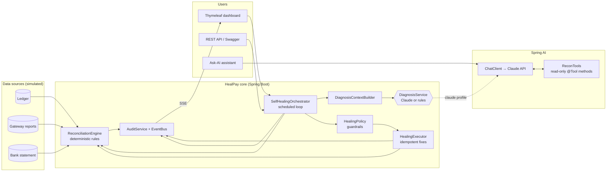
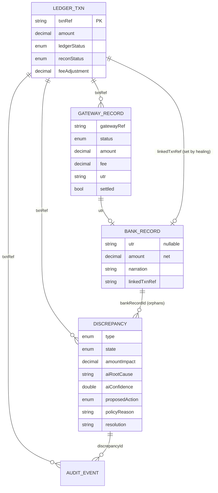
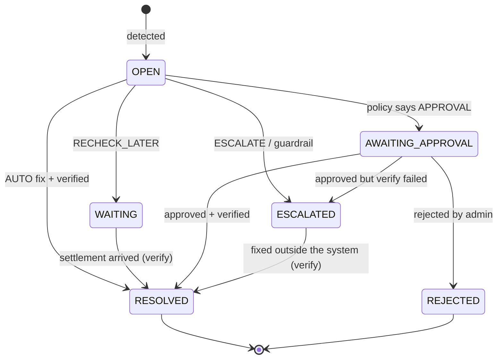
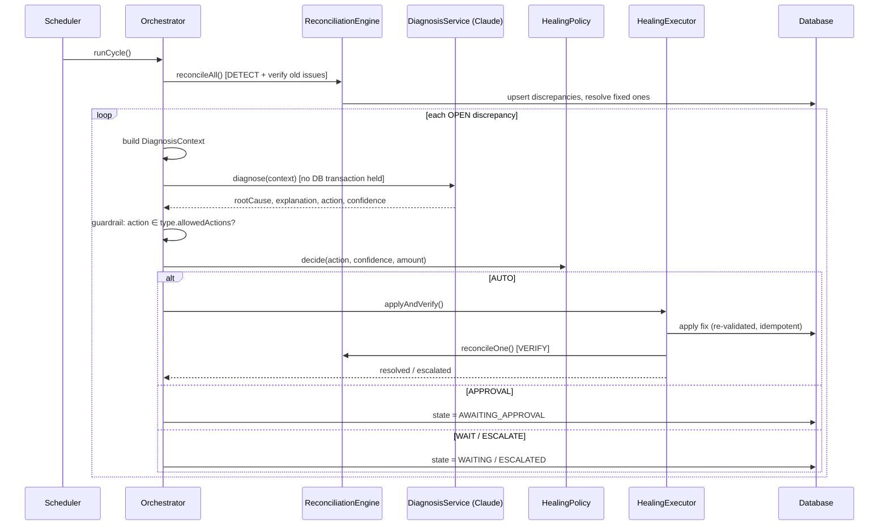

# HealPay AI — Developer Guide

This guide explains how the system works, where each piece of code lives, and how to extend it.
For the product pitch, see [`HACKATHON.md`](HACKATHON.md).

- [1. Concepts](#1-concepts)
- [2. Architecture](#2-architecture)
- [3. Running locally](#3-running-locally)
- [4. Code map](#4-code-map)
- [5. Domain model](#5-domain-model)
- [6. The self-healing loop](#6-the-self-healing-loop)
- [7. Reconciliation rules](#7-reconciliation-rules)
- [8. AI integration (Spring AI + Claude)](#8-ai-integration-spring-ai--claude)
- [9. Healing policy and guardrails](#9-healing-policy-and-guardrails)
- [10. Healing actions](#10-healing-actions)
- [11. The simulator](#11-the-simulator)
- [12. UI and live updates](#12-ui-and-live-updates)
- [13. REST API](#13-rest-api)
- [14. Security](#14-security)
- [15. Configuration reference](#15-configuration-reference)
- [16. Testing](#16-testing)
- [17. Extending the system](#17-extending-the-system)
- [18. Path to production](#18-path-to-production)
- [19. Troubleshooting](#19-troubleshooting)

---

## 1. Concepts

| Term | Meaning |
|---|---|
| **Ledger** | Our own record of each payment (`LedgerTransaction`). What *we* believe happened. |
| **Gateway record** | What the payment gateway reports: capture status, fee, settlement UTR (`GatewayRecord`). Source of truth for *capture*. |
| **Bank credit** | A line in the bank statement: the settlement actually received (`BankRecord`). Source of truth for *money in*. |
| **Three-way reconciliation** | Checking that ledger ⇄ gateway ⇄ bank agree on status, amount, fee and settlement. |
| **Discrepancy / exception** | One detected mismatch (`Discrepancy`), together with its AI diagnosis, policy decision and outcome. |
| **Healing action** | One of a *closed* set of fixes the system knows how to apply (`HealingAction`). |
| **MDR** | Merchant Discount Rate, the gateway fee. Contracted at 2% in the demo config. |
| **UTR** | Unique Transaction Reference of a bank transfer; used to match settlements. |

## 2. Architecture



**Design principles**

1. **Money math is deterministic.** Matching, totals and fee checks are plain Java rules. The AI never computes balances.
2. **The AI proposes, the policy disposes.** Claude picks a fix from a closed list. Java code decides whether it may run.
3. **Read-only AI tools.** The model can look data up; it has no tool that writes.
4. **Every fix is verified.** After an action, the transaction is re-reconciled. If it still doesn't balance, the case is escalated.
5. **Everything is audited.** Each step is an `AuditEvent`. The audit trail drives the timeline and the live feed.
6. **Graceful degradation.** No API key, or API down → rule-based diagnosis. The loop keeps healing.

## 3. Running locally

| Mode | Command | Database | AI |
|---|---|---|---|
| Default | `mvn spring-boot:run` | H2 in-memory | rule-based mock |
| Real AI | `ANTHROPIC_API_KEY=… mvn spring-boot:run -Dspring-boot.run.profiles=claude` | H2 | Claude |
| Docker | `docker compose up -d --build` | PostgreSQL | mock, or Claude with `SPRING_PROFILES_ACTIVE=postgres,claude` |

Useful URLs:

| URL | What |
|---|---|
| `http://localhost:8080/` | Dashboard (login `admin/admin123`) |
| `/swagger-ui.html` | Interactive API docs |
| `/v3/api-docs` | OpenAPI JSON |
| `/actuator/health` | Health check (public) |

Build a runnable jar: `mvn package` → `target/healpay.jar` → `java -jar target/healpay.jar`.

## 4. Code map

```
com.healpay
├── HealPayApplication            entry point (@EnableScheduling, @ConfigurationPropertiesScan)
├── config/
│   ├── AppProperties             typed app.* settings (records)
│   ├── SecurityConfig            form login + HTTP Basic, ADMIN / VIEWER roles
│   └── Fmt                       ₹ / time formatting for templates (@fmt)
├── domain/                       JPA entities + enums (no JPA relationships, joined by reference strings)
│   ├── LedgerTransaction, GatewayRecord, BankRecord, Discrepancy, AuditEvent
│   └── LedgerStatus, GatewayStatus, ReconStatus, DiscrepancyType, DiscrepancyState, HealingAction, Actor
├── repo/                         Spring Data repositories
├── recon/
│   ├── ReconciliationEngine      DETECT + VERIFY: rules, discrepancy upsert, status derivation
│   └── ReconSummaryService       KPI numbers
├── ai/
│   ├── DiagnosisService          interface → MockDiagnosisService | ClaudeDiagnosisService
│   ├── ClaudeDiagnosisService    Spring AI ChatClient, structured output, tool calling, fallback
│   ├── RuleBasedDiagnosisService deterministic diagnosis (mock + fallback)
│   ├── AssistantService          interface → MockAssistantService | ClaudeAssistantService
│   ├── ReconTools                @Tool methods (read-only) exposed to Claude
│   ├── DiagnosisContext(+Builder) what the AI sees about a discrepancy
│   ├── AiDiagnosis               structured output record
│   └── FuzzyMatcher              reference similarity for messy bank narrations
├── healing/
│   ├── SelfHealingOrchestrator   the loop; approve / reject
│   ├── HealingPolicy             AUTO / APPROVAL / WAIT / ESCALATE rules
│   └── HealingExecutor           applies fixes, re-validates, verifies
├── simulator/
│   ├── PaymentSimulator          seeds data, injects incidents, delivers delayed settlements
│   └── Scenario                  incident catalogue
├── events/
│   ├── AuditService              writes AuditEvent + publishes
│   └── EventBus                  SSE fan-out to browsers
└── web/
    ├── PageController            Thymeleaf pages
    ├── TransactionQueryService   read-side queries
    └── api/                      REST controllers + error handler
```

## 5. Domain model



Entities are linked by business keys (`txnRef`, `utr`) rather than JPA associations. This mirrors
real reconciliation, where feeds arrive independently, and it avoids lazy-loading surprises.

**Statuses shown to users (`ReconStatus`)**

| Status | Meaning |
|---|---|
| `MATCHED` | All three sources agree; never had an issue |
| `HEALED` | Had an issue, now balanced (auto-healed, approved, or self-resolved) |
| `SETTLEMENT_PENDING` | Captured, waiting for the bank credit inside the lag window |
| `AWAITING_APPROVAL` | A fix is proposed and needs a human |
| `MANUAL_REVIEW` | Escalated or rejected; ops must handle it |
| `MISMATCH` | Detected, not yet processed by the loop |

**Exception lifecycle (`DiscrepancyState`)**



## 6. The self-healing loop

`SelfHealingOrchestrator.runCycle()` runs every `app.healing.cycle-interval-ms` (30 s by default),
or on demand from the dashboard (**Run healing now**) or `POST /api/recon/run`.



Notes:

- **Single-flight.** A `ReentrantLock` makes sure only one cycle runs at a time. A second trigger returns "skipped".
- **Short transactions.** Detection runs in one transaction. Each decide-and-act runs in its own short
  transaction via `TransactionTemplate`. AI calls happen in between, so a slow model never holds DB locks.
- **Stale check.** If a discrepancy changed while the AI was thinking (e.g. resolved by a settlement), it is skipped.
- **No loops.** A `REJECTED` discrepancy is kept while the issue persists, so the AI does not keep re-proposing it.

## 7. Reconciliation rules

Implemented in `ReconciliationEngine.detect(LedgerTransaction)`. Tolerance is ₹0.01.

| # | Condition | Discrepancy | Amount at risk |
|---|---|---|---|
| 1 | Ledger `SUCCESS`, no gateway record | `MISSING_IN_GATEWAY` | amount |
| 2 | More than one `SUCCESS` capture for one `txnRef` | `DUPLICATE_DEBIT` | amount × (n − 1) |
| 3 | Gateway `SUCCESS`, ledger not `SUCCESS` | `STATUS_MISMATCH` | amount |
| 4 | Gateway `FAILED`/`REFUNDED`, ledger `SUCCESS` | `STATUS_MISMATCH` | amount |
| 5 | Gateway amount ≠ ledger amount | `AMOUNT_MISMATCH` | difference |
| 6 | Gateway fee ≠ `amount × feeRate + feeAdjustment` | `FEE_VARIANCE` | variance |
| 7 | No bank credit (by UTR or `linkedTxnRef`), captured < lag hours ago | `SETTLEMENT_DELAYED` | net |
| 8 | Same, captured ≥ lag hours ago | `MISSING_IN_BANK` | net |
| 9 | Bank credit ≠ gateway net (amount − fee) | `AMOUNT_MISMATCH` | difference |
| 10 | Unlinked bank credit whose UTR matches no gateway record | `ORPHAN_BANK_CREDIT` | credit |

Rule 10 skips credits whose amount equals an active `MISSING_IN_BANK` exception, so the same problem
isn't reported twice while the link is being worked on.

**Upsert semantics** (`reconcileOne`): for each detected issue, the latest discrepancy of that type is
updated if it isn't `RESOLVED`; otherwise a new `OPEN` one is created. Active discrepancies whose issue is
no longer detected are resolved with "Verified: ledger, gateway and bank now balance". This is the VERIFY step.

## 8. AI integration (Spring AI + Claude)

### Switching providers

| `app.ai.provider` | Beans activated | Needs key? |
|---|---|---|
| `mock` (default) | `MockDiagnosisService`, `MockAssistantService` | No |
| `claude` (profile `claude`) | `ClaudeDiagnosisService`, `ClaudeAssistantService` | `ANTHROPIC_API_KEY` |

The default `application.yml` sets `spring.ai.model.chat: none`, which disables the Anthropic
auto-configuration so the app boots without a key. `application-claude.yml` switches it to `anthropic`
and sets the model (`CLAUDE_MODEL`, default `claude-haiku-5-5`, which is fast and cheap for classification).

### Diagnosis call

```java
AiDiagnosis result = chatClient.prompt()
        .user(u -> u.text("Diagnose this discrepancy ...\n\n{context}")
                    .param("context", context.toPromptText()))
        .tools(tools)                     // read-only ReconTools
        .call()
        .entity(AiDiagnosis.class);       // structured output → Java record
```

- **System prompt** (`ClaudeDiagnosisService.SYSTEM_PROMPT`) sets the role, the output contract
  (one action from `ALLOWED ACTIONS`, a confidence between 0 and 1, `bankRecordId` for links) and domain heuristics.
- **Context** (`DiagnosisContext.toPromptText()`) includes the discrepancy, ledger row, gateway records,
  matched bank credit, **bank candidates with code-computed similarity scores**, the contracted fee and the allowed actions.
- **Structured output.** Spring AI's `BeanOutputConverter` adds a JSON schema to the prompt and parses the reply into `AiDiagnosis`.
- **Fallback.** Any exception (network, rate limit, bad JSON) → `RuleBasedDiagnosisService`, with the explanation tagged "[AI unavailable]".

### Tools Claude can call (`ReconTools`)

| Tool | Returns |
|---|---|
| `getTransaction(txnRef)` | Ledger row, open issues, last 10 timeline events |
| `listTransactionsByStatus(status)` | Up to 20 transactions |
| `listActiveExceptions()` | Active discrepancies with AI root cause / proposed action |
| `getReconSummary()` | KPI map |
| `findBankCandidates(txnRef)` | Unlinked bank credits with amount match + similarity |

There is deliberately **no write tool**. Changing data is only possible through `HealingExecutor`, after `HealingPolicy`.

### Assistant

`ClaudeAssistantService` uses the same tools with a short system prompt ("always use tools, never guess
numbers, under 120 words"). `RuleBasedAssistantService` handles common questions with keyword matching
and is the fallback.

### Fuzzy reference matching

Banks often truncate references. `FuzzyMatcher.similarity(narration, refs…)` = longest common alphanumeric
substring ÷ reference length (overlaps under 4 characters are ignored). It's deterministic and explainable,
and the AI receives the score instead of guessing. The rule-based diagnosis maps it to
`confidence = 0.5 + 0.5 × similarity`.

### Cost control

- One LLM call per *new* discrepancy (not per transaction, not per cycle).
- Small model by default; `max-tokens: 1024`, `temperature: 0.1`.
- Clean transactions never reach the AI.

## 9. Healing policy and guardrails

`HealingPolicy.decide(action, confidence, amountImpact, txn)`. The rules are evaluated in this order:

| # | Rule | Result |
|---|---|---|
| 1 | Action is `ESCALATE` or missing | **ESCALATE** |
| 2 | Action is `RECHECK_LATER` | **WAIT** |
| 3 | Action moves money (`REFUND_DUPLICATE`, `REVERSE_LEDGER_ENTRY`) | **APPROVAL**, always |
| 4 | `SYNC_STATUS_FROM_GATEWAY` would downgrade a `SUCCESS` ledger entry | **APPROVAL** |
| 5 | Confidence < `app.healing.min-confidence` (0.80) | **APPROVAL** |
| 6 | Fee adjustment or link with amount > `app.healing.auto-heal-limit` (₹5,000) | **APPROVAL** |
| 7 | Otherwise | **AUTO** |

Additional guardrails (defence in depth):

| Layer | Where | What |
|---|---|---|
| Allowed actions per type | `DiscrepancyType.allowedActions` + orchestrator | AI output outside the list → overridden to `ESCALATE` |
| Link requires a target | orchestrator | `LINK_BANK_RECORD` without `bankRecordId` → `ESCALATE` |
| Precondition re-check | `HealingExecutor` | e.g. link only if the bank amount equals the expected net; reverse only if the gateway is not `SUCCESS` |
| Idempotency | `HealingExecutor` | Re-applying a fix is a no-op ("no change") |
| Verification | `HealingExecutor` → `reconcileOne` | Not balanced afterwards → `ESCALATED` + `VERIFY_FAILED` event |
| Audit | `AuditService` | Every decision and change is recorded with its actor (`AI`, `USER`, `SYSTEM`…) |

## 10. Healing actions

| Action | Effect | Moves money | Preconditions re-checked |
|---|---|---|---|
| `SYNC_STATUS_FROM_GATEWAY` | Ledger status := gateway status | No | Gateway record exists |
| `POST_FEE_ADJUSTMENT` | `feeAdjustment += variance` (ledger adjustment entry) | No | Variance smaller than the payment |
| `LINK_BANK_RECORD` | `bank.linkedTxnRef := txnRef`; closes matching orphan | No | Credit unlinked, amount = expected net |
| `REFUND_DUPLICATE` | Extra captures → `REFUNDED` (simulated gateway refund) | **Yes** | ≥ 2 successful captures |
| `REVERSE_LEDGER_ENTRY` | Ledger `SUCCESS` → `FAILED` | **Yes** | Gateway not `SUCCESS` |
| `RECHECK_LATER` | No change; re-checked every cycle | No | — |
| `ESCALATE` | No change; ops handle it | No | — |

In production, `REFUND_DUPLICATE` would call the gateway's refund API (with an idempotency key) instead of flipping a status.

## 11. The simulator

`PaymentSimulator` stands in for real ingestion. On startup (if the DB is empty) it seeds
`app.simulator.seed-count` payments: **one of every incident first** (so a fresh start always has
`TXN-100001` … `TXN-100007` as incidents), then about 80% clean traffic.

| Scenario | What it generates |
|---|---|
| `CLEAN` | Ledger, gateway and bank all match |
| `FAILED_CLEAN` | Failed everywhere (no issue) |
| `MISSED_WEBHOOK` | Gateway `SUCCESS`, ledger stuck `PENDING` |
| `DUPLICATE_CAPTURE` | Two captures 40 s apart, two bank credits |
| `FEE_GST` | Fee = contracted fee × 1.18 |
| `TRUNCATED_REF_STRONG` | Bank credit without UTR; narration keeps 11 of 13 ref characters |
| `TRUNCATED_REF_WEAK` | Same; only a 6-character fragment |
| `GATEWAY_FAILED_LEDGER_SUCCESS` | Ledger booked success from a client redirect; gateway failed |
| `DELAYED_SETTLEMENT` | Captured now; bank credit arrives after `delayed-settlement-seconds` (90 s) |
| `ORPHAN_CREDIT` | Unknown bank credit |

Inject a fresh batch any time: dashboard **Inject demo incidents** or `POST /api/simulator/incidents`.

**Replacing it with real data:** implement ingestion jobs that write `GatewayRecord` (from settlement
reports or webhooks) and `BankRecord` (from MT940/CSV statements), and create `LedgerTransaction`s from
your order service. Nothing else changes.

## 12. UI and live updates

- Server-rendered **Thymeleaf** templates in `src/main/resources/templates`, plain CSS in `static/css/app.css`,
  and ~200 lines of vanilla JS in `static/js/app.js`. No build step, no CDN.
- **Live updates.** Every `AuditEvent` is pushed over **Server-Sent Events** (`GET /api/events/stream`).
  The dashboard prepends to the feed and refreshes KPIs. A transaction page appends to its timeline.
  Toasts show heals, approvals and escalations.
- Pages: `/` dashboard, `/transactions`, `/transactions/{ref}`, `/exceptions?state=…`, `/assistant`, `/login`.

## 13. REST API

All endpoints need authentication (HTTP Basic or a browser session). Full schema: `/swagger-ui.html`.

| Method | Path | Role | Description |
|---|---|---|---|
| GET | `/api/transactions?q=&status=` | VIEWER | Search transactions |
| GET | `/api/transactions/{txnRef}` | VIEWER | Detail: gateway, bank, exceptions, timeline |
| GET | `/api/exceptions?state=ACTIVE` | VIEWER | `ACTIVE`, `ALL` or a specific state |
| GET | `/api/exceptions/{id}` | VIEWER | One exception |
| POST | `/api/exceptions/{id}/approve` | ADMIN | Approve → apply → verify |
| POST | `/api/exceptions/{id}/reject` | ADMIN | Body `{"reason": "..."}` (optional) |
| GET | `/api/recon/summary` | VIEWER | KPIs |
| POST | `/api/recon/run` | ADMIN | Run one cycle now; returns a `CycleReport` |
| POST | `/api/simulator/incidents` | ADMIN | Inject one of every incident |
| POST | `/api/simulator/seed?count=20` | ADMIN | Generate traffic |
| POST | `/api/assistant/ask` | VIEWER | Body `{"question": "..."}` |
| GET | `/api/events/stream` | VIEWER | SSE stream of audit events |

Examples:

```bash
curl -u viewer:viewer123 http://localhost:8080/api/transactions/TXN-100001
curl -u admin:admin123 -X POST http://localhost:8080/api/recon/run
curl -u viewer:viewer123 -H 'Content-Type: application/json' \
     -d '{"question":"What is waiting for approval?"}' http://localhost:8080/api/assistant/ask
```

Errors use RFC 7807 problem JSON (404 not found, 409 wrong state).

## 14. Security

- In-memory users from config (`ADMIN_USER/ADMIN_PASSWORD`, `VIEWER_USER/VIEWER_PASSWORD`). **Change the defaults before exposing the app.**
- `ADMIN` can approve or reject fixes, run cycles and inject data. `VIEWER` is read-only (plus Ask AI).
- UI forms are CSRF-protected. CSRF is disabled for `/api/**`, which uses Basic auth or the session.
- `/actuator/health`, `/login`, static assets and `/error` are public.
- The Claude API key is read only from the environment (`ANTHROPIC_API_KEY`) and never logged.
- `server.forward-headers-strategy: framework` gives correct redirects behind Cloudflare Tunnel or Nginx.

## 15. Configuration reference

| Property | Env var | Default | Purpose |
|---|---|---|---|
| `app.ai.provider` | (profile `claude`) | `mock` | AI implementation |
| `spring.ai.anthropic.api-key` | `ANTHROPIC_API_KEY` | — | Claude key (claude profile) |
| `spring.ai.anthropic.chat.options.model` | `CLAUDE_MODEL` | `claude-haiku-5-5` | Model |
| `app.healing.enabled` | `HEALING_AUTO` | `true` | Scheduled loop on/off (manual "Run now" always works) |
| `app.healing.cycle-interval-ms` | `HEAL_CYCLE_MS` | `30000` | Loop interval |
| `app.healing.min-confidence` | `MIN_CONFIDENCE` | `0.80` | Below → approval |
| `app.healing.auto-heal-limit` | `AUTO_HEAL_LIMIT` | `5000` | INR limit for auto fee adjustments / links |
| `app.recon.expected-fee-rate` | — | `0.02` | Contracted MDR |
| `app.recon.settlement-lag-hours` | — | `24` | Delayed vs missing settlement |
| `app.simulator.seed-on-startup` | `SEED_ON_STARTUP` | `true` | Seed when DB empty |
| `app.simulator.seed-count` | — | `40` | Seed size |
| `app.simulator.delayed-settlement-seconds` | `DELAYED_SETTLEMENT_SECONDS` | `90` | When delayed credits arrive |
| `app.display-zone` | `DISPLAY_ZONE` | `Asia/Kolkata` | UI time zone |
| `server.port` | `PORT` | `8080` | HTTP port |
| `spring.datasource.*` | `DB_URL`, `DB_USER`, `DB_PASSWORD` | H2 | Database (postgres profile) |

Profiles: `postgres` (PostgreSQL), `claude` (real AI), `test` (tests: loop and seeding off).

## 16. Testing

```bash
mvn test
```

| Test | Covers |
|---|---|
| `HealingPolicyTest` | Every policy branch (money moves, confidence, limit, downgrade, wait/escalate) |
| `FuzzyMatcherTest` | Strong / weak / unrelated narration scoring |
| `SelfHealingFlowTest` | End to end: inject all incidents → one cycle → assert HEALED / AWAITING_APPROVAL / SETTLEMENT_PENDING → approve the duplicate → HEALED → second cycle is a no-op |

Tests always use the rule-based AI, so they are deterministic and need no key.

## 17. Extending the system

### Add a new incident type

1. Add a value to `DiscrepancyType` with its label and **allowed actions**.
2. Add a detection rule in `ReconciliationEngine.detect()`.
3. Add a branch in `RuleBasedDiagnosisService.diagnose()`. The switch is exhaustive, so the compiler reminds you.
4. Optionally add a heuristic line to `ClaudeDiagnosisService.SYSTEM_PROMPT`.
5. Add a `Scenario` and builder case in `PaymentSimulator`, and extend `SelfHealingFlowTest`.

### Add a new healing action

1. Add it to `HealingAction` (set `movesMoney` correctly).
2. Implement it in `HealingExecutor.apply()`: re-validate preconditions, make it idempotent, return a human-readable message.
3. Allow it on the relevant `DiscrepancyType`s.
4. Add a policy rule if it needs special handling, plus a test in `HealingPolicyTest`.

### Add an AI tool

Add a `@Tool`-annotated **read-only** method to `ReconTools`. Return small records, not entities.
Both Claude services pick it up automatically.

### Add Python (only if needed)

A good fit would be a trained anomaly-detection model (e.g. Isolation Forest on transaction patterns).
Run it as a small FastAPI service and call it from a new `DiagnosisContextBuilder` enrichment step.
The core loop needs no Python.

## 18. Path to production

- [ ] Replace the simulator with real ingestion (gateway webhooks / settlement API / SFTP, bank MT940/CSV).
- [ ] Schema migrations with Flyway instead of `ddl-auto: update`.
- [ ] Paged, indexed queries (`reconcileAll` and search currently scan; fine up to tens of thousands of rows).
- [ ] Real refund call with idempotency keys; double-entry ledger postings for adjustments.
- [ ] SSO / OIDC instead of in-memory users; four-eyes approval for large amounts.
- [ ] ShedLock (or similar) if running more than one instance, so only one node runs the loop.
- [ ] Metrics (Micrometer → Prometheus): heal rate, time-to-heal, AI latency/cost, fallback rate.
- [ ] Prompt and response logging (with PII masking) for AI evaluation.
- [ ] RAG over past incidents and runbooks (Spring AI `VectorStore` + PGVector) for richer explanations.

## 19. Troubleshooting

| Symptom | Fix |
|---|---|
| App fails at startup with `ANTHROPIC_API_KEY` placeholder error | You enabled the `claude` profile without the key. Export it or drop the profile. |
| Badge shows "rule-based mock" | `app.ai.provider` is `mock`; start with profile `claude`. |
| Explanations end with "[AI unavailable …]" | Claude call failed (key, quota, network). Check logs for `Claude diagnosis failed`. |
| Live dot stays grey | SSE is blocked by a proxy. With Nginx, set `proxy_buffering off;` for `/api/events/stream`. |
| Delayed settlement never resolves | It resolves 90 s after capture plus the next cycle (≤ 30 s). |
| Lost demo data after restart | The default H2 is in-memory. Use the `postgres` profile (Docker) to persist. |
| Out of memory on a 1 GB VM | Use `docker-compose.gcp.yml` (heap 320 MB) and add swap (`deploy/gcp/setup-vm.sh`). |
