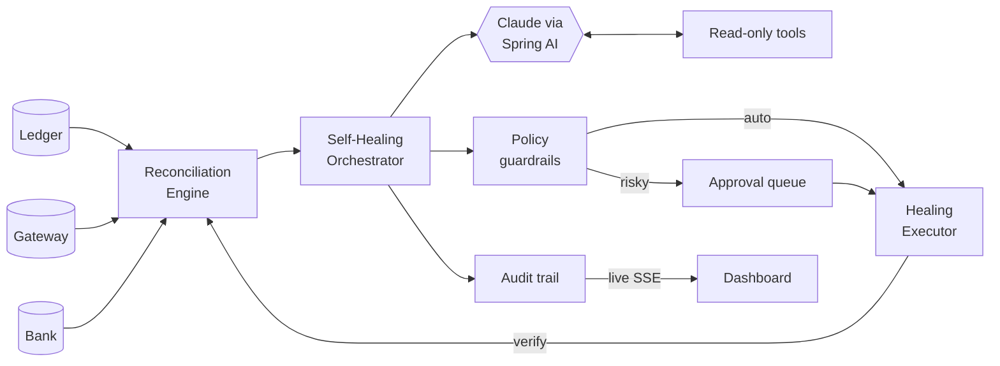

# 🏆 HealPay AI: a self-healing payment balancing system

**Tagline:** *Payments that fix themselves, safely.*

**Track:** AI for FinTech / Operations · **Built with:** Spring Boot, Spring AI, Claude

---

## 1. The problem

Every company that takes digital payments runs a daily **reconciliation**: does what *our ledger* says
match what the *payment gateway* captured and what the *bank* actually received?

They often don't, for boring and expensive reasons:

- 📡 A **success webhook times out**, so the customer paid but the order says *pending*.
- 🔁 A customer **taps "Pay" twice** and is charged twice.
- 🧾 The gateway deducts **GST on top of the fee**, so the totals are off by a few rupees on thousands of rows.
- 🏦 The bank file **drops or truncates the UTR**, so the money arrived but can't be matched.
- 🐞 A client-side redirect **books "success" for a payment that failed**.

Today, operations teams fix these by hand in spreadsheets. The work is slow, repetitive and error-prone,
and every unresolved item means a customer waiting on an order, a merchant waiting on money, or
finance unable to close the books.

## 2. Our solution

HealPay AI turns reconciliation from a **daily manual chore** into a **continuous, self-healing loop**:

```
  ┌──────────┐   ┌──────────────┐   ┌──────────────┐   ┌────────┐   ┌──────────┐
  │  DETECT  │ → │  DIAGNOSE 🤖 │ → │ DECIDE 🛡️    │ → │  ACT   │ → │  VERIFY  │
  │ 3-way    │   │ Claude finds │   │ Guardrails:  │   │ Safe,  │   │ Re-check │
  │ recon    │   │ root cause & │   │ auto, human, │   │ audited│   │ it really│
  │ rules    │   │ proposes fix │   │ wait, or esc.│   │ fixes  │   │ balances │
  └──────────┘   └──────────────┘   └──────────────┘   └────────┘   └──────────┘
```

1. **Detect.** A deterministic engine compares ledger ⇄ gateway ⇄ bank every 30 seconds.
2. **Diagnose.** **Claude** (through **Spring AI**) reads the evidence, can call read-only tools to look up more,
   and returns a structured diagnosis: *root cause, plain-English explanation, recommended fix, confidence*.
3. **Decide.** A **policy engine written in plain Java** decides whether the fix may run on its own.
4. **Act.** Safe fixes are applied automatically: sync a missed webhook, post a fee adjustment, link a truncated bank credit.
5. **Verify.** The system re-reconciles. Only if everything balances is the case closed; otherwise it escalates.

Risky fixes, like **refunds** or **reversals**, go to an **approval queue** with the AI's explanation attached,
so a human decides in one click instead of investigating from scratch.

## 3. What makes it different

| Idea | Why it matters |
|---|---|
| **"The AI proposes, the policy disposes."** | The LLM never moves money. It chooses from a closed list of fixes, and Java rules decide. This makes AI usable in a regulated domain. |
| **Verification after every fix** | A fix only "counts" if the books actually balance afterwards. No silent failures. |
| **Read-only AI tools** | Claude can investigate (look up transactions, find bank candidates) but has no write access. |
| **Deterministic money math** | Matching and totals are rules, not AI, so they're auditable and reproducible. |
| **Explainable fuzzy matching** | Truncated bank references are scored by code (e.g. "85% similar"), and the AI reasons over that score. |
| **Graceful degradation** | If the AI is down, a rule-based diagnoser takes over and the loop keeps healing. |
| **Full audit trail + live timeline** | Every step of every payment is visible, streamed live to the dashboard. |
| **Ask-AI assistant** | Ops staff ask *"Why is TXN-100006 not reconciled?"* and get an answer grounded in real data. |

## 4. Demo highlights

A fresh start seeds 40 payments, including one of each incident. One click on **Run healing now**:

| Payment | Incident | What HealPay does |
|---|---|---|
| TXN-100001 | Missed success webhook | 🤖 Diagnoses it, syncs the status from the gateway, verifies → **auto-healed** |
| TXN-100002 | Customer charged twice | 🤖 Proposes a refund → **waits for approval** (moves money) |
| TXN-100003 | GST on top of MDR | 🤖 Explains the 18% variance, posts an adjustment → **auto-healed** |
| TXN-100004 | Bank dropped the UTR (strong match) | 🤖 Fuzzy-matches the narration (≈85%), links the credit → **auto-healed** |
| TXN-100005 | Bank dropped the UTR (weak match) | 🤖 Proposes a link at ≈73% confidence → **waits for approval** |
| TXN-100006 | Ledger success, gateway failed | 🤖 Proposes a reversal → **waits for approval** |
| TXN-100007 | Settlement in transit | ⏳ Waits; when the credit arrives about 90 s later → **self-resolved** |
| (bank) | Unknown credit | 🚩 Escalated to operations |

*See [`DEMO_SCRIPT.md`](DEMO_SCRIPT.md) for the click-by-click version.*

## 5. Architecture at a glance



**Tech:** Java 21 · Spring Boot 3.5 · **Spring AI 1.0** (Anthropic starter: `ChatClient`, structured output via `.entity()`,
`@Tool` tool calling) · Spring Data JPA (H2 / PostgreSQL) · Spring Security · Thymeleaf + Server-Sent Events ·
Docker · runs free on Google Cloud e2-micro.

## 6. How we use AI (Spring AI features)

| Spring AI feature | Where | What it does |
|---|---|---|
| `ChatClient` fluent API | `ClaudeDiagnosisService`, `ClaudeAssistantService` | One clean call per diagnosis or question |
| **Structured output** `.entity(AiDiagnosis.class)` | Diagnosis | Claude's answer arrives as a typed Java record, with no fragile parsing |
| **Tool calling** `@Tool` | `ReconTools` | Claude looks up transactions, exceptions and bank candidates on demand |
| System prompts with domain heuristics | Both services | Encodes payments know-how (webhooks, GST on MDR, T+1 settlement) |
| Provider switch by profile | `application-claude.yml` | Same code runs with Claude or offline rules |

## 7. Impact (what we'd measure in a pilot)

We don't claim numbers we haven't measured. In a pilot these are the metrics that matter, and the dashboard
already tracks most of them:

- **Auto-heal rate:** the share of exceptions closed with no human (shown live on the dashboard).
- **Time-to-heal:** from detection to verified balance (seconds instead of the next business day).
- **Amount at risk:** money stuck in unresolved exceptions (shown live).
- **Analyst minutes per exception:** the approval queue arrives pre-investigated, with a root cause and a proposed fix.
- **Customer-facing wins:** "paid but pending" orders fixed before the customer contacts support.

## 8. Safety and trust

- Money-moving actions **always** require a human.
- AI confidence below 0.80 → human.
- Balance-changing fixes above ₹5,000 → human.
- Proposals outside the allowed list are **overridden to escalate**.
- Every fix is **re-validated** before running and **verified** after.
- Full **audit trail** with actor (AI / user / system) for every step.

## 9. Roadmap

1. **Real connectors:** Razorpay/Stripe settlement APIs, bank MT940/CSV ingestion.
2. **Incident memory (RAG):** "this looks like incident #231, fixed by X", using Spring AI `VectorStore` + PGVector.
3. **Learning thresholds:** raise auto-heal limits per incident type as approval history shows the AI is reliable.
4. **Proactive alerts:** Slack/Teams messages with one-click approve.
5. **Anomaly detection:** an optional Python model for unusual fee or failure patterns.
6. **Multi-entity, multi-currency** reconciliation.

## 10. Try it

```bash
mvn spring-boot:run                    # offline, rule-based AI
# or, with Claude:
ANTHROPIC_API_KEY=... mvn spring-boot:run -Dspring-boot.run.profiles=claude
```

Open <http://localhost:8080> → `admin / admin123`.

---

### Judging criteria mapping

| Criterion | Where we address it |
|---|---|
| **Innovation** | A closed-loop *self-healing* system rather than a chatbot; the AI acts within guardrails and is verified |
| **Technical depth** | 3-way recon engine, structured output, tool calling, policy engine, idempotent executor, SSE, tests |
| **Practicality** | Runs offline, deploys free, real payments failure modes, clear path to production |
| **Responsible AI** | Human-in-the-loop for money, read-only tools, confidence thresholds, audit trail, fallback |
| **Demo quality** | One-click incidents, live feed, explanations visible on every exception |

### Team

| Name | Role |
|---|---|
| _your name_ | _role_ |
